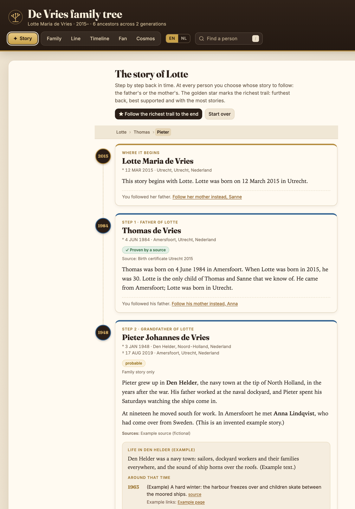

# Family Tree Research

I've been researching my own family tree with Claude, including the Swedish origin of our family name. I started with an export of an old Ancestry project. Claude checked every connection and added a lot of new ancestors, every one of them with a source. I turned it into a plugin, so you can do the same.

Start with what you know (yourself, your parents, your grandparents) or with a GEDCOM export from Ancestry or MyHeritage. Claude searches public archives, notes for each ancestor how sure it is, and builds an interactive family tree. It works in **English and Dutch**. My favourite part is the Story view: you walk back through the generations and read how each of them lived.



Not every archive lets Claude in. When one doesn't, Claude tells you exactly what to look up and asks for a screenshot.

## Install (with automatic updates)

1. Open the Claude app → **Customize** → **Plugins**.
2. Click **Add** (top right) → **Add marketplace** and enter: `chriswaalberg/family-tree-research`
3. Install **family-tree-research**.
4. Turn on automatic updates: first select the **Plugins** tab, then click **Add** (top right) → **Manage marketplaces** → **···** next to family-tree-research → **Sync automatically**.

**Not getting the latest version?** Customize → **Plugins** → **Add** → **Manage marketplaces** → **···** → **Check for updates**. The "Synced commit" there should match the latest commit on GitHub.

## Get started

1. Create an empty folder on your computer, e.g. `Family tree`.
2. Start a new Cowork task and add that folder (**Add folder**).
3. Type **/family-tree-research:family-tree** or just say: **"I want to research my family tree."** (Dutch works too: "Ik wil mijn stamboom uitzoeken.")

Continuing later? New task, same folder, and say: **"Continue my family tree."**

More about what the plugin does: [plugins/family-tree-research/README.md](plugins/family-tree-research/README.md)

## Or if you prefer Claude Code

```
/plugin marketplace add chriswaalberg/family-tree-research
/plugin install family-tree-research@chriswaalberg
```

## Found something?

A great-great-grandparent, or a bug? [Open an issue](https://github.com/chriswaalberg/family-tree-research/issues). I'd love to hear both.

## License

MIT, see [LICENSE](LICENSE).
